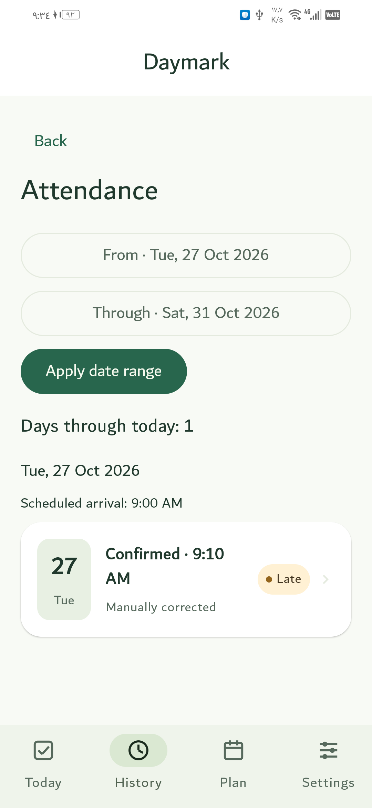

# Daymark

Daymark is a personal attendance tracker for work, school, and courses. Set a weekly schedule, register a place, confirm attendance with a location check, and review your history or manage time off. Records are saved locally and work offline without an account. You can optionally sync an outgoing report to Google Sheets.

The Android and iOS apps share Kotlin and Compose Multiplatform code. A desktop build is available for development. Live Google authorization, signed-device behavior, and distribution still have open verification gates. See the [release verification record](docs/development/release-verification.md).



*Android History with test data.*

## What you can do

- **Today** shows your current attendance status and a monthly summary, and lets you start a location check.
- **History** shows attendance by date, including whether an entry came from a location check or a manual correction.
- **Plan** manages days off, holidays, vacations, and Work missions. Future vacation reserves days from the Work vacation balance.
- **Settings** manages your registered place, weekly schedule, grace period, and optional Google Sheets connection. Choose System, English, or Arabic for language and System, Light, or Dark for appearance.

Daymark supports one personal tracker, one registered place, and one weekly schedule per installation. Checks use the saved attendance time zone. A valid location fix at or before the grace deadline counts as Present. A later eligible foreground check counts as Late. Schedule and place changes take effect the next attendance-zone day and preserve past records. See the [attendance design](docs/superpowers/reviews/2026-10-27-attendance-mvp/04-promoted-design-v2.md).

## Platform behavior

| Platform | Attendance flow |
| --- | --- |
| Android | Foreground location checks and, when enabled and permitted, one best-effort automatic attempt per scheduled day during the arrival-to-deadline window. WorkManager skips the location request if the attempt runs after the deadline. The widget opens the foreground check. |
| iOS | Foreground location checks and optional arrival reminders covering the next 30 calendar days. Open the check from the app, a reminder, or the widget. Location checks run in the foreground. |
| Desktop | Development host outside the mobile MVP. Foreground location checks are available on macOS. Reminders and widgets are unavailable on desktop. |

## Local data and Google Sheets

Room is the source of truth. If you connect Google, Daymark uses the `drive.file` scope to update an app-created report. Direct spreadsheet edits are never imported and may be overwritten. Android can upload through network-constrained background work. iOS uploads at foreground opportunities, so changes can stay pending until you reopen the app.

Registered-place coordinates stay on the device, and raw check coordinates are discarded after evaluation. Disconnecting Google or deleting local data leaves the existing report in Drive. Reinstalling can erase local records, and Daymark cannot restore them from Sheets.

Google setup is optional. See [Android and iOS provisioning](docs/development/provisioning.md) or [desktop OAuth setup](docs/development/desktop-google-oauth.md) to try reporting.

## Development setup

Use **JDK 21** and the checked-in Gradle wrapper. For Android, install **SDK Platform 37**, then set `sdk.dir` in an untracked `local.properties` file. Android compiles and targets API 37 and supports API 26 and later. The iOS app deployment target is iOS 16. See the [version catalog](gradle/libs.versions.toml), [wrapper configuration](gradle/wrapper/gradle-wrapper.properties), [Android build](androidApp/build.gradle.kts), and [Xcode project](iosApp/Daymark.xcodeproj/project.pbxproj) for the checked-in settings.

### Android

```sh
./gradlew :androidApp:assembleDebug
./gradlew :androidApp:installDebug
```

Run `installDebug` with an emulator or device connected, then open Daymark from the launcher.

### iOS

On macOS, open `iosApp/Daymark.xcodeproj` in Xcode, select the **Daymark** scheme and a simulator, and run. The build phase uses JDK 21 and invokes `:shared:embedAndSignAppleFrameworkForXcode`. Physical-device builds require signing configuration.

### Desktop

```sh
./gradlew :desktopApp:run
```

### Tests

```sh
./gradlew :shared:jvmTest :shared:testAndroidHostTest :androidApp:testDebugUnitTest
./gradlew :androidApp:connectedDebugAndroidTest
./gradlew :shared:iosSimulatorArm64Test
```

Connected Android tests require an emulator or device. The iOS test task requires macOS, Xcode, and a compatible Apple Silicon simulator. See the [release verification record](docs/development/release-verification.md) for recorded results and open acceptance checks.

## Repository layout

| Path | Contents |
| --- | --- |
| `shared/` | Compose UI, ViewModels, attendance rules, Room storage, Ktor reporting, and platform adapters |
| `androidApp/` | Android app, WorkManager scheduling, Google authorization, and Glance widget |
| `iosApp/` | Swift host, native integrations, and WidgetKit extension |
| `desktopApp/` | Compose Desktop host and macOS native helpers |

See the [architecture guide](docs/development/architecture.md) for module boundaries and data flow.

## Design references

- [Promoted design v2](docs/superpowers/reviews/2026-10-27-attendance-mvp/04-promoted-design-v2.md), [frozen v1 contract](docs/superpowers/reviews/2026-10-27-attendance-mvp/01-design-v1-frozen.md), and [implementation plan](docs/superpowers/plans/2026-10-27-attendance-mvp.md)
- [Senior review](docs/superpowers/reviews/2026-10-27-attendance-mvp/03-senior-review.md) and [research pack](docs/superpowers/reviews/2026-10-27-attendance-mvp/02-research-pack.md)
- [Interactive visual concept](docs/superpowers/specs/assets/daymark-concept.html), [light preview](docs/superpowers/specs/assets/daymark-light-preview.png), and [dark preview](docs/superpowers/specs/assets/daymark-dark-preview.png) with simulated integrations
